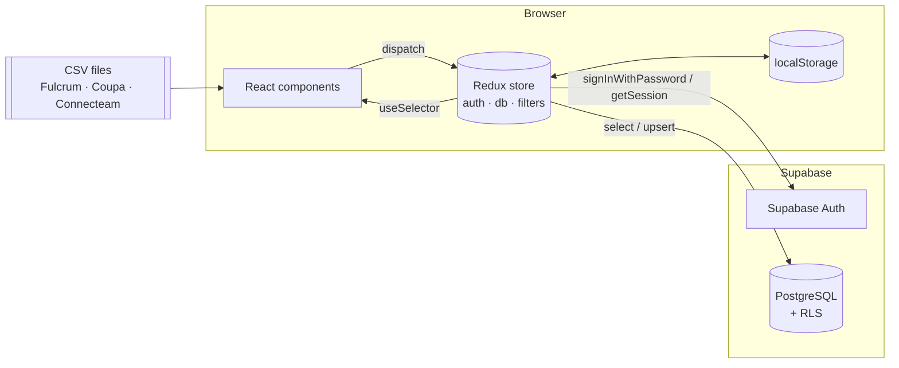
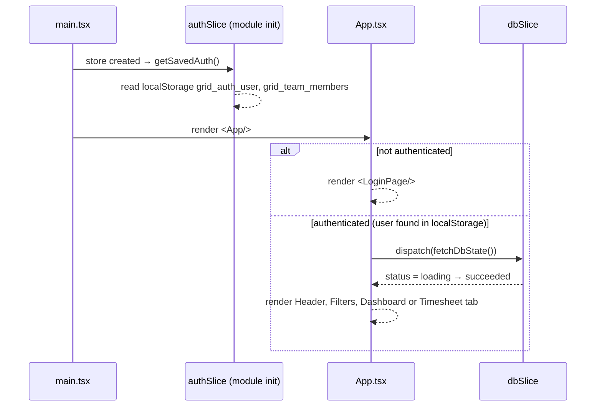
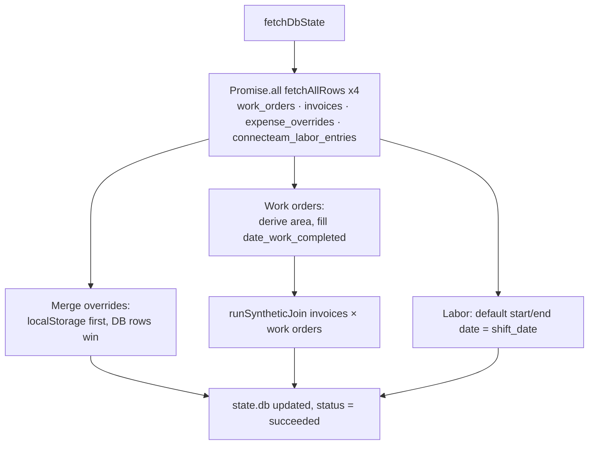
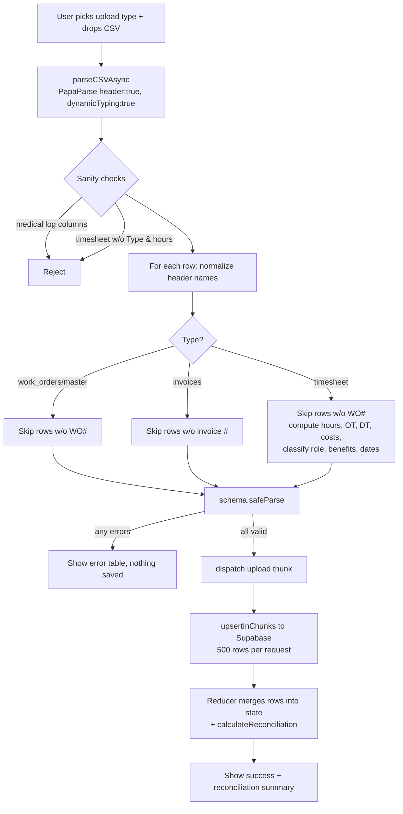
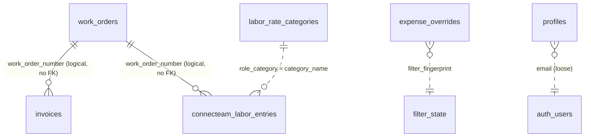

# Power Grid Utilities Console — Developer Guide

This guide explains how the whole application works: the architecture, the runtime flows, every Redux slice and thunk, every helper function, every component, every database table, and the business calculations. It also lists known gaps and pitfalls you should be aware of before changing things.

> Line references (e.g. `dbSlice.ts:138`) point to the code as of the initial commit. If they drift, search for the function name.

---

## Table of contents

1. [What the app does](#1-what-the-app-does)
2. [Tech stack](#2-tech-stack)
3. [Getting started](#3-getting-started)
4. [Project structure](#4-project-structure)
5. [Architecture overview](#5-architecture-overview)
6. [Runtime flows](#6-runtime-flows)
7. [Redux store reference](#7-redux-store-reference)
8. [Data schemas (Zod)](#8-data-schemas-zod)
9. [Utility functions reference](#9-utility-functions-reference)
10. [Components reference](#10-components-reference)
11. [Business calculations](#11-business-calculations)
12. [Roles and permissions](#12-roles-and-permissions)
13. [Database reference](#13-database-reference)
14. [Browser storage (localStorage)](#14-browser-storage-localstorage)
15. [CSV upload formats](#15-csv-upload-formats)
16. [Build, lint, and deployment](#16-build-lint-and-deployment)
17. [Known gaps, pitfalls, and tech debt](#17-known-gaps-pitfalls-and-tech-debt)
18. [How to… (common changes)](#18-how-to-common-changes)

---

## 1. What the app does

The console is a single-page web app for a utility contractor. It combines three external data sources that are uploaded as CSV files:

| Source system | Data | Stored in table |
|---|---|---|
| **Fulcrum** | Work orders (jobs in the field: crew, address, status, prerequisites) | `work_orders` |
| **Coupa** | Invoices billed to the customer | `invoices` |
| **Connecteam** | Employee timesheets (shifts, hours, pay, overtime, benefits) | `connecteam_labor_entries` |

From these it computes:

- **Revenue** (invoiced amount), **labor cost**, and **profit margin** per filter selection, crew, and day.
- **Crew performance** per General Foreman and Foreman.
- **Labor role classification** (General Foreman, Foreman, Journeyman, …) inferred from hourly rate and crew assignments.

There are three user roles — **Supervisor**, **Admin**, **Employee** — and each sees a different amount of financial data.

---

## 2. Tech stack

| Concern | Library | Notes |
|---|---|---|
| UI | React 19 + TypeScript 6 | Mix of JSX and raw `React.createElement` calls (both styles exist in the codebase). |
| Build tool | Vite 8 | `vite.config.ts` splits vendor chunks (`vendor-react`, `vendor-charts`, `vendor-ui`). |
| State | Redux Toolkit 2 + react-redux 9 | Three slices: `auth`, `db`, `filters`. |
| Backend | Supabase (PostgreSQL + Auth) | Called directly from the browser with the anon key; security relies on Row Level Security. |
| Validation | Zod 4 | Row-level validation of uploaded CSVs. |
| CSV parsing | PapaParse | Runs on the main thread. |
| File drop | react-dropzone | Upload modal. |
| Charts | Recharts 3 | Bar charts on the dashboard. |
| Styling | Tailwind CSS 4 (via `@tailwindcss/vite`) | Utility classes inline. `App.css` is legacy Vite boilerplate. |
| Animation / icons | framer-motion, lucide-react | |
| Lint | oxlint | `npm run lint`. |

> The README mentions "React 18" and "SheetJS (`xlsx`)" — both are outdated. The app uses React 19, and only CSV is supported (no `xlsx` dependency).

Installed but currently **unused**: `@tanstack/react-table`, `@tanstack/react-virtual`.

---

## 3. Getting started

### Prerequisites

- Node.js 18+
- A Supabase project

### Environment variables

Copy `.env.example` to `.env`:

```env
VITE_SUPABASE_URL=https://<your-project>.supabase.co
VITE_SUPABASE_ANON_KEY=<anon public key>
```

Both are read in `src/utils/supabaseClient.ts`. If they are missing, the client is created with empty strings and every request fails silently (the app will show empty data, not an error).

### Database setup

Open the Supabase SQL editor and run `supabase_schema.sql`. It is idempotent (`IF NOT EXISTS`, `DROP … IF EXISTS`), so you can re-run it.

### Create the first user

There is no sign-up page. Create the first user in the Supabase dashboard (**Authentication → Users → Add user**) and set its **user metadata** so it gets the Supervisor role:

```json
{ "name": "Your Name", "role": "Supervisor" }
```

A user without `role` in metadata is treated as `Employee`.

### Run

```bash
npm install
```

```bash
npm run dev
```

```bash
npm run build
```

---

## 4. Project structure

```
grid-utilities-console/
├── index.html                    # HTML shell, mounts #root, loads src/main.tsx
├── vite.config.ts                # React + Tailwind plugins, manual vendor chunks
├── supabase_schema.sql           # Full DB schema: tables, seed, constraints, view, RLS
├── supabase_schema_SECURITY_FIX.sql  # Currently byte-identical to supabase_schema.sql
├── .env.example                  # Supabase URL + anon key template
├── public/                       # favicon.svg, icons.svg
└── src/
    ├── main.tsx                  # React root + Redux <Provider>
    ├── App.tsx                   # Auth gate, tab switching, lazy-loaded panels/modals
    ├── index.css                 # Tailwind import + base styles
    ├── App.css                   # Unused Vite boilerplate
    ├── store/
    │   ├── store.ts              # configureStore: { filters, db, auth }
    │   ├── authSlice.ts          # Login, session, profile, team management
    │   ├── dbSlice.ts            # Load + upload work orders / invoices / labor; overrides
    │   └── filtersSlice.ts       # Global dashboard filters
    ├── types/
    │   └── schemas.ts            # Zod schemas + inferred TS types
    ├── utils/
    │   ├── supabaseClient.ts     # Supabase client singleton
    │   ├── helpers.ts            # All business logic helpers (costs, roles, dates, join)
    │   ├── excelTemplates.ts     # Downloadable CSV templates
    │   ├── parseCSV.ts           # PapaParse wrapper (used)
    │   └── papaparseWorker.ts    # Duplicate of parseCSV.ts (unused, not actually a worker)
    ├── assets/
    │   ├── synthetic_invoices.json      # Sample data (not imported anywhere)
    │   └── synthetic_work_orders.json   # Sample data (not imported anywhere)
    └── components/
        ├── LoginPage.tsx
        ├── Header.tsx
        ├── Filters.tsx
        ├── Kpis.tsx
        ├── CrewMetricsTable.tsx
        ├── ProfitMarginOverTime.tsx      # Supervisor only, lazy
        ├── ServiceMap.tsx                # Supervisor only, lazy ("Profit Margin Performance")
        ├── UploadModal.tsx               # Lazy
        ├── UserSettingsModal.tsx         # Lazy
        ├── TimesheetTab.tsx              # Lazy
        ├── Timesheet/
        │   ├── timesheetHelpers.ts
        │   ├── TimesheetSummaryCards.tsx
        │   ├── TimesheetTable.tsx
        │   ├── TimesheetRoleBreakdown.tsx
        │   └── TimesheetRollupModal.tsx
        ├── ApprovedVsUnapprovedChart.tsx # NOT rendered anywhere
        ├── MoneyHeldAging.tsx            # NOT rendered anywhere
        ├── ServiceRequirements.tsx       # NOT rendered anywhere
        ├── StatusDaysChart.tsx           # NOT rendered anywhere
        └── StatusPercentage.tsx          # NOT rendered anywhere
```

---

## 5. Architecture overview

The app is **frontend-only**. There is no custom API server: the browser talks directly to Supabase using the public anon key plus the logged-in user's JWT. All aggregation (KPIs, margins, role classification) happens **in the browser** over the full dataset, which is loaded into Redux once after login.



Key design points:

- **Single source of truth in memory.** `fetchDbState` downloads every row of `work_orders`, `invoices`, `expense_overrides`, and `connecteam_labor_entries` (paged 1000 at a time). Components derive everything with `useMemo`.
- **Filters are global.** `filtersSlice` holds the selection; every dashboard component re-filters the raw arrays itself.
- **Uploads write to Supabase first, then merge into Redux.** Upload thunks upsert to the DB and return the rows; reducers merge them into state without re-fetching.
- **Role gating is mostly UI-side.** RLS policies in Postgres also restrict access (e.g. employees cannot read invoices), but see [§17](#17-known-gaps-pitfalls-and-tech-debt) for weaknesses.

---

## 6. Runtime flows

### 6.1 App boot



1. `main.tsx` creates the React root and wraps `<App/>` in the Redux `<Provider>`.
2. When `authSlice.ts` is first imported, `getSavedAuth()` reads `grid_auth_user` and `grid_team_members` from localStorage. If a user is there, `isAuthenticated` starts as `true`.
3. When `dbSlice.ts` is first imported, it deletes old timesheet cache keys (`grid_utilities_timesheets*`) and loads persisted expense overrides.
4. `App.tsx` shows `LoginPage` if not authenticated. Otherwise an effect dispatches `fetchDbState()` (it runs again whenever `isAuthenticated` changes).

> `checkSessionThunk` exists but is **never dispatched**. The app trusts the cached user in localStorage at startup; the Supabase JS client separately restores its own session from its own storage key.

### 6.2 Login

1. `LoginPage` validates locally: `validateEmailAddress()` and a minimum password length of 6.
2. Dispatches `loginThunk({ email, password })`.
3. `loginThunk` calls `supabase.auth.signInWithPassword`. On success it builds a `UserProfile` from the auth user:
   - `role` = `user_metadata.role` or `'Employee'`
   - `name` = `user_metadata.name` → `user_metadata.full_name` → email prefix
4. The profile is saved to `localStorage.grid_auth_user` and put in `state.auth.currentUser`; `isAuthenticated = true`.
5. `App`'s effect sees the change and dispatches `fetchDbState()`.

On failure, `authError` is set and shown in the form. Typing in either field clears it (`clearAuthError`).

### 6.3 Logout

`Header` → `dispatch(logout())`. The reducer clears `currentUser`, `previewRole`, `isAuthenticated`, removes `grid_auth_user`, and calls `supabase.auth.signOut()` (fire-and-forget inside the reducer). Data in the `db` slice is **not** cleared; it is replaced on the next login.

### 6.4 Loading data — `fetchDbState`



- `fetchAllRows(table)` pages with `.range(from, to)` in steps of 1000 until a short page comes back. **Errors stop paging silently** (for example, RLS denial on `invoices` for an Employee returns an empty array).
- Work orders get:
  - `area` = stored area, or `deriveArea(address, lat, lng)`
  - `date_work_completed` = stored Fulcrum completion date, or — only in memory, via `withDerivedCompletionDate`, if the status counts as completed — `customer_need_date`, or the hardcoded `'2026-08-15'`.
- Invoices go through `runSyntheticJoin` to attach a `work_order_number` and `link_source` (see [§11.6](#116-invoice--work-order-linking-runsyntheticjoin)).
- If anything throws, the thunk **resolves** with empty arrays (it never rejects), so `status` becomes `succeeded` with no data.

### 6.5 CSV upload

All four upload types go through `UploadModal.onDrop`:



Important behaviour:

- **All-or-nothing validation.** If any row fails Zod validation, nothing is uploaded.
- **Header normalization** is type-specific. Leading `_` is stripped (Fulcrum exports `_status`, `_latitude`, …). See [§15](#15-csv-upload-formats) for accepted column names.
- The thunk is awaited with `.unwrap()`, so DB errors appear in the error table as field `Persist DB`.

Per-type thunk behaviour:

| Type | Thunk | What it writes |
|---|---|---|
| Work Orders | `uploadWorkOrdersThunk` | `formatWorkOrderForUpload` → dedupe by `work_order_number` → `upsertWorkOrders` (conflict on `work_order_number`). The real `date_work_completed` is saved; rows without one omit the column. |
| Invoices | `uploadInvoicesThunk` | Filters empty invoice numbers → inserts placeholder work orders (`Unassigned GF`, `Pending Location`, …) for referenced `work_order_number`s **that don't exist yet** (`ignoreDuplicates: true`, i.e. `ON CONFLICT DO NOTHING`; existing work orders are never modified) → upsert `invoices` (conflict on `invoice_number`). Placeholders are not added to Redux until the next reload. |
| Timesheet | `uploadTimesheetThunk` | Recomputes OT/DT/benefits/line cost as fallback → assigns a UUID (new one if the row has no valid UUID) → upsert `connecteam_labor_entries` (conflict on `id`). If that fails, retries without `dt_*`, `benefits_*`, `start_date`, `end_date` (for older schemas). |
| Master Joined | `uploadJoinedMasterThunk` | One CSV with work order + invoice columns. Upserts work orders, then invoices for rows that have an `invoice_number`. **Errors are swallowed**: on failure it still resolves and Redux shows rows that were not saved. |

After each upload the reducer computes a **reconciliation summary** (`calculateReconciliation`): for each affected work order, it counts whether it now has both invoice and labor ("ready with margin calculated") or invoice only ("awaiting labor data").

### 6.6 Filtering

`Filters.tsx` dispatches `setFilters({...})` / `resetFilters()`. Every consumer re-derives its data with `useMemo` keyed on `filters`. Clicking a row in `CrewMetricsTable` also sets the General Foreman / Foreman filters.

Selecting a new General Foreman clears the Foreman selection. The Foreman dropdown is disabled until a General Foreman is chosen. The Work Order # list is scoped by the selected crew.

The `area` and `status` filters exist in state, but **there is no UI to change them** (the status select is commented out in `Filters.tsx`), so they always stay at "All".

### 6.7 Expense overrides

On the KPI "Total Labor Cost" card, Supervisors and Admins can enter **Expense Add** and **Expense Less** amounts; Supervisors can click the pencil to override the **Profit Margin** value.

1. The override is keyed by a **filter fingerprint**: `getFilterFingerprint(filters)` → JSON string of the current filters. Each filter combination has its own override.
2. On blur / Enter, `saveOverrideThunk` upserts into `expense_overrides` (conflict on `filter_fingerprint`). DB errors are only logged.
3. The reducer stores it in `state.db.overrides` and mirrors it to `localStorage.grid_utilities_overrides_v3`.
4. On load, localStorage overrides are merged first and then DB values overwrite them.

### 6.8 Team management (User Settings)

`UserSettingsModal` has three tabs: **Profile**, **Password**, and **Team** (Supervisor only).

| Action | Thunk | Effects |
|---|---|---|
| Save profile | `updateProfileThunk` | `auth.updateUser({ email?, data:{name} })`, upsert `profiles` row, update localStorage user + team list. |
| Change password | `updatePasswordThunk` | `auth.updateUser({ password })`. |
| Invite member | `inviteTeamMemberThunk` | `auth.signUp` with given or generated password and metadata `{name, role}`; if sign-up errors (e.g. already registered) sends a password-reset email instead. Upserts `profiles` with id `user-<timestamp>`. Adds to local team list. Returns the password so the modal can show / copy it. |
| Change role | `updateTeamMemberRoleThunk` | Updates `profiles.role` (matched by id or email) and the local list. **Does not change the auth user's `user_metadata.role`, which is what actually controls access.** |
| Remove member | `removeTeamMemberThunk` | Deletes the `profiles` row and removes from local list. **Does not delete or disable the auth user.** |

The team list itself is **only stored in localStorage** (`grid_team_members`); it is never loaded from the `profiles` table. A Supervisor on another browser sees an empty team list.

---

## 7. Redux store reference

`src/store/store.ts`:

```ts
configureStore({ reducer: { filters, db, auth } })
export type RootState, AppDispatch
```

### 7.1 `auth` slice — `src/store/authSlice.ts`

**Types**

| Type | Fields |
|---|---|
| `UserRole` | `'Supervisor' \| 'Admin' \| 'Employee'` |
| `UserProfile` | `id, email, name, role, avatarUrl?, createdAt, lastLogin?` |
| `TeamMember` | `id, name, email, role, status ('Active'\|'Invited'\|'Pending'), invitedAt` |

**State**

| Field | Meaning |
|---|---|
| `currentUser` | Logged-in profile or `null`. |
| `previewRole` | UI-only role preview for Supervisors (the UI to set it is currently commented out in `Header`). |
| `isAuthenticated` | Drives the login gate in `App`. |
| `isLoading` | Login / invite in progress. |
| `authError` | Message shown on login form / settings. |
| `teamMembers` | Team list (localStorage-backed). |
| `inviteSuccessMessage` | Banner text after invite. |

**Sync reducers**

| Action | Effect |
|---|---|
| `setUiPreviewRole(role\|null)` | Sets `previewRole` only if the actual user is a Supervisor. |
| `clearUiPreviewRole()` | Clears it. |
| `setCurrentUser(profile)` | Sets user, `isAuthenticated = true`, writes localStorage. |
| `logout()` | Clears user + preview, removes localStorage user, calls `supabase.auth.signOut()`. |
| `clearAuthError()` / `clearInviteMessage()` | Reset messages. |

**Thunks**

| Thunk | Input | Output | Notes |
|---|---|---|---|
| `checkSessionThunk` | — | `UserProfile \| null` | Builds profile from `getSession()`. Not used. |
| `loginThunk` | `{email, password}` | `UserProfile` | Lower-cases email. Rejects with Supabase message. |
| `updateProfileThunk` | `{name, email}` | `{user, team}` | Validates email; Supabase errors are non-fatal. |
| `updatePasswordThunk` | `{newPassword}` | `true` | |
| `inviteTeamMemberThunk` | `{name, email, role, password?}` | `{member, team, password}` | Password: given one if ≥ 6 chars, else `generateSecureRandomPassword(14)`. |
| `updateTeamMemberRoleThunk` | `{memberId, newRole}` | `{memberId, newRole, team, currentUser}` | Also updates current user if it is the same person. |
| `removeTeamMemberThunk` | `{memberId, email}` | `{memberId, email, team}` | |

**Exported helper**: `generateSecureRandomPassword(length = 18)` — uses `crypto.getRandomValues` over a charset without ambiguous characters (no `0/O/1/l/I`).

### 7.2 `db` slice — `src/store/dbSlice.ts`

**State (`DbState`)**

| Field | Initial | Meaning |
|---|---|---|
| `workOrders` | `[]` | All work orders. |
| `invoices` | `[]` | All invoices, after `runSyntheticJoin`. |
| `laborEntries` | `[]` | All timesheet rows. |
| `laborRateCategories` | `DEFAULT_LABOR_RATE_CATEGORIES` | Rate card (hardcoded; DB table is not read). |
| `overrides` | from localStorage | `{ [fingerprint]: {add_amount, remove_amount, profit_margin_override?} }` |
| `dailyExpenseRate` | `5800` | $ per foreman per booked day (hardcoded, no UI to change). |
| `reconciliationSummary` | `null` | Last upload summary. |
| `status` | `'idle'` | `'idle' \| 'loading' \| 'succeeded' \| 'failed'` |

**Private helpers**

| Function | Purpose |
|---|---|
| `loadPersistedOverrides()` / `savePersistedOverrides()` | Read / write `grid_utilities_overrides_v3`. |
| `deduplicateByKey(items, keyFn)` | Last row wins for duplicate keys; drops empty keys. |
| `fetchAllRows(table)` | Paged `select('*')`, 1000 rows/page. Stops on error. |
| `generateUUID()` *(exported)* | `crypto.randomUUID()` with RFC4122 v4 fallback. |
| `isValidUUID(id)` | Regex check. |
| `upsertInChunks(table, items, onConflict?, ignoreDuplicates?)` | Upserts in batches of 500; throws on error. With `ignoreDuplicates = true`, existing rows are left untouched (insert-only). |
| `calculateReconciliation(...)` | Builds `ReconciliationSummary` (see §6.5). |

**Thunks**: `fetchDbState`, `uploadWorkOrdersThunk`, `uploadInvoicesThunk`, `uploadTimesheetThunk`, `uploadJoinedMasterThunk`, `saveOverrideThunk` — described in §6.4, §6.5, §6.7.

**Reducer merge rules**

| Action | Merge |
|---|---|
| `fetchDbState.fulfilled` | Replace all arrays and overrides. |
| `uploadWorkOrdersThunk.fulfilled` | Upsert by `work_order_number` (shallow merge into existing). |
| `uploadInvoicesThunk.fulfilled` | `runSyntheticJoin` the new invoices, then upsert by `invoice_number`. |
| `uploadTimesheetThunk.fulfilled` | `unshift` every entry (no dedupe). |
| `uploadJoinedMasterThunk.fulfilled` | Work orders then invoices, as above. |
| `saveOverrideThunk.fulfilled` | Set `overrides[fingerprint]`, persist to localStorage. |
| `clearReconciliationSummary()` | Sync reducer; resets summary. |

### 7.3 `filters` slice — `src/store/filtersSlice.ts`

| Field | Default | Set by |
|---|---|---|
| `startDate` / `endDate` | `null` | Date inputs (`YYYY-MM-DD`). |
| `generalForeman` | `'All crews'` | GF select, crew table row click. |
| `foreman` | `[]` | Foreman multi-select, crew table row click. Empty = all. |
| `workOrderNumbers` | `[]` | WO multi-select. Empty = all. |
| `area` | `'All areas'` | No UI. |
| `status` | `'All statuses'` | No UI (commented out). Applies to invoice status. |

Actions: `setFilters(partial)` (shallow merge), `resetFilters()`.

---

## 8. Data schemas (Zod)

All in `src/types/schemas.ts`. TypeScript types are inferred from them (`WorkOrder`, `Invoice`, `ExpenseOverride`, `LaborRateCategory`, `LaborEntry`). Schemas are used **only** during CSV upload validation; data loaded from Supabase is not re-validated.

### `normalizeWorkOrderStatus(val)`

Maps free-text status to one of five canonical values (case-insensitive, checked in this order):

| Contains / equals | Result |
|---|---|
| "ready to bill", "ready_to_bill", "ready for bill", "billing", "billed" | `Ready to Bill` |
| "ctcc" | `CTCC Completed` |
| "field complete", "completed", "complete" | `Field Complete` |
| "field check", or anything containing "check" | `Field Check` |
| "pending", "in progress", "open" | `Work Pending` |
| anything else / empty | `Work Pending` |

### `WorkOrderSchema`

- `work_order_number`: number or string → trimmed string.
- `status`: normalized as above.
- `general_foreman` / `foreman` / `address` / `area`: empty or `"null"` → `'Unassigned GF'` / `'Unassigned Foreman'` / `'Pending Location'` / `'HOUSTON'`.
- `latitude` / `longitude`: parsed float or `null`.
- Boolean flags (`switching_required`, `outage_required`, `permitting_needed`, `locked_gates`, `traffic_control_needed`, `hydrovac_needed`, `tree_trimming_needed`): `true` only for `true`, `'yes'`, `'true'`.
- Notes fields → string or `null`. Date fields are passed through untyped.

### `InvoiceSchema`

- `invoice_number`: required; rejects `''`, `'0'`, `'null'`, `'undefined'`.
- `status`: any string, default `'Unapproved'` (`InvoiceStatusEnum` lists the six allowed values, but any string passes the client schema — the DB check constraint is stricter).
- `total`: parsed float, default `0`.
- `link_source`: `'native' | 'synthetic'`, default `'synthetic'`.
- `unanswered_comments`: `true` for `true`/`'yes'`/`'true'`.

### `MasterJoinedSchema`

Work order fields (as above) plus invoice fields: `invoice_number` (nullable; `n/a`, `0`, etc. → `null`), `invoice_status`, `po_number`, `total`, `created_date`, `unanswered_comments`.

### `LaborEntrySchema`

- `work_order_number`: required, not `''` or `'0'`.
- `employee_name`, `shift_date`: required non-empty strings.
- `shift_hours`, `hourly_rate`, `line_labor_cost`: numbers ≥ 0.
- `ot_*`, `dt_*`, `benefits_*`: coerced to number, default `0`.
- `role_category`: default `'unclassified'`.

### `ExpenseOverrideSchema`, `LaborRateCategorySchema`

Defined for completeness; not used for validation at runtime.

---

## 9. Utility functions reference

### 9.1 `src/utils/helpers.ts`

| Function / constant | Description |
|---|---|
| `DEFAULT_LABOR_RATE_CATEGORIES` | The rate card (see §11.1). Single source of rates for the whole app. |
| `KNOWN_SECONDARY_LABOR_RATES` | Extra rates that map to a role (alternate pay tiers). |
| `formatCurrency(val)` | `$1,234.56` (USD, 2 decimals). Several components define their own local `formatCurrency` with different rounding. |
| `formatHours(val)` | `"8.5 hrs"`. |
| `getLaborRoleRates(roleName, categories)` | Finds a category by name (case-insensitive; treats `gforeman` = `general foreman`). |
| `getLaborRoleBenefitsRate(roleName, categories)` | That category's `benefits_rate`, or `0`. |
| `calculateLaborEntryCost(entry, categories)` | Full line cost for one shift (see §11.2). Used by `Kpis`. |
| `classifyLaborRole(rate, categories, name?, workOrder?, allGf?, allForemen?)` | Role inference (see §11.3). |
| `parseHoursToDecimal(val)` | `"08:30"` → `8.5`; numbers pass through; invalid → `0`. |
| `isWorkOrderCompleted(status)` | `true` for `Field Complete`, `CTCC Completed`, `Ready to Bill`. |
| `formatWorkOrderForUpload(wo)` | Normalizes a WO row for upsert. Defaults lat/lng to downtown Houston (`29.7604, -95.3698`); stores only the real `date_work_completed` from the file (see `withDerivedCompletionDate` for the in-memory fallback). |
| `HOUSTON_BOUNDS` | Lat/lng box for Greater Houston (exported, unused). |
| `parseExcelDate(val)` | Excel serial (number or numeric text, days since 1899-12-30), ISO, `YYYY/MM/DD`, `M/D/YYYY` or other date text → `YYYY-MM-DD` with no timezone shift; invalid → `null`. |
| `normalizeDateForStorage(val)` | `parseExcelDate` result, or the trimmed original text if unrecognised; empty → `null`. |
| `runSyntheticJoin(invoices, workOrders)` | Links invoices to work orders (see §11.6). Returns `[]` if there are no work orders. |
| `deriveArea(address, lat?, lng?)` | Region from coordinates boxes, then address keywords / ZIPs (see §11.7). |
| `getFilterFingerprint(filters)` | Stable JSON key for override storage. |
| `validateEmailAddress(val)` | Returns an error message or `''`. Rejects numeric-only usernames, usernames < 2 chars, numeric domain parts. |
| `getWorkOrderReportingDate(wo)` | Date used to filter work orders: `date_work_completed` → `customer_need_date` → `created_date` → `created_at`. **Never** Fulcrum's "last updated" (that changes on every edit). |
| `getInvoiceDate(inv)` | `created_date` → `created_at`. |

### 9.2 `src/utils/laborCost.ts` — the labor calculation engine

**Every** labor cost and role in the app goes through this module (dashboard KPIs, timesheet table, role breakdown, WO rollup, upload persistence, position preview). Do not add cost formulas anywhere else.

| Function | Description |
|---|---|
| `normalizeEmployeeKey(name)` | Employee identity key: trim, collapse whitespace, lower-case. Must match the DB check constraint. |
| `normalizeEmployeeDisplayName(name)` | Trim + collapse whitespace, case kept. |
| `buildLaborCalcContext(workOrders, categories, positions)` | Builds `{ categories, employeePositions, woMap, gfNames, foremanNames }`. Use `selectLaborCalcContext` instead of calling it in components. |
| `getEmployeePositionOverride(name, positions)` | The saved override for an employee, if any. |
| `inferEntryRole(entry, ctx)` | Automatic role (crew name, then rate), ignoring overrides. |
| `resolveEntryRole(entry, ctx)` | Role with precedence: override → crew → rate → `unclassified`. |
| `priceLaborEntry(entry, { role, hourlyRate, categories, trustStoredCosts })` | Pure formula (§11.2). With `trustStoredCosts`, positive stored OT/DT/benefits/line costs are reused. |
| `computeLaborEntryCost(entry, ctx)` | Effective `LaborCostBreakdown`: applies the override (rate + role, all costs recomputed) or falls back to source pricing. |
| `validateHourlyRateInput(raw)`, `MAX_EMPLOYEE_HOURLY_RATE` | Rate validation shared by the modal (DB enforces the same range). |

React components get these through the `useLaborCost()` hook (`src/hooks/useLaborCost.ts`), which returns `{ ctx, getBreakdown }`. `getBreakdown(entry)` is memoized for all loaded entries and recomputes when entries, work orders, the rate card or overrides change.

`src/components/Timesheet/timesheetHelpers.ts` now only contains display helpers: `getRoleDisplayName(role)` and `getRoleCategoryBadge(role)`.

### 9.3 Other utils

| File | Exports |
|---|---|
| `supabaseClient.ts` | `supabase` — the single client instance. |
| `parseCSV.ts` | `parseCSVAsync(file)` — PapaParse with `header`, `skipEmptyLines`, `dynamicTyping`. |
| `papaparseWorker.ts` | Same function; unused duplicate. |
| `excelTemplates.ts` | `downloadWorkOrderTemplate()`, `downloadInvoiceTemplate()`, `downloadTimesheetTemplate()` — build an RFC-4180 CSV in memory and trigger a download. |

---

## 10. Components reference

### Layout

```
App
├── LoginPage                         (when not authenticated)
└── (authenticated)
    ├── Header                        tabs, upload button, user menu
    ├── Filters                       global filter bar
    ├── Dashboard tab
    │   ├── Kpis
    │   ├── CrewMetricsTable
    │   └── (Supervisor) ProfitMarginOverTime + ServiceMap   [lazy]
    ├── Timesheet tab
    │   └── TimesheetTab                                     [lazy]
    │       ├── TimesheetSummaryCards
    │       ├── TimesheetTable
    │       ├── TimesheetRoleBreakdown
    │       └── TimesheetRollupModal
    ├── UploadModal                                          [lazy, on demand]
    └── UserSettingsModal                                    [lazy, on demand]
```

Lazy components are loaded with `React.lazy` + `Suspense` and show `ComponentLoadingFallback`.

### Component details

| Component | Reads from store | What it does |
|---|---|---|
| **`App`** | `db.status`, `auth` | Login gate; dispatches `fetchDbState` after auth; local state for active tab and open modals; computes `displayRole` (preview role if a Supervisor set one). |
| **`LoginPage`** | `auth.isLoading`, `auth.authError` | Email/password form with touched-state validation; dispatches `loginThunk`. |
| **`Header`** | `db.workOrders/invoices` (counts), `auth` | Brand, role badge, record counts, tab switcher, **Upload Data** button (hidden for Employees), user menu (Settings, Sign out). Shows an amber banner when a preview role is active. The "as of" date is hardcoded to `18 Aug 2026`. |
| **`Filters`** | `filters`, `db` | Date range, GF select, Foreman multi-select (requires GF), searchable WO # multi-select, a **Sync** button (only shows a "coming soon" toast), and **Reset**. |
| **`Kpis`** | `filters`, `db`, `auth` | Employee: 3 operational cards (total WOs, completion rate, pending). Admin: Invoiced Amount + Total Labor Cost (with add/less inputs). Supervisor: those plus Profit Margin (editable override). See §11.4. |
| **`CrewMetricsTable`** | `filters`, `db`, `auth` | Per-Foreman or per-GF table: WOs, % complete, booked days, hours (`days × 8`), revenue, expense, margin (columns gated by role). Client-side pagination. Clicking a row sets crew filters. Uses the **booked-days** expense model (§11.5). |
| **`ProfitMarginOverTime`** | `filters`, `db` | Daily margin bar chart. Default window: 60 days ending `2026-08-18` (hardcoded); max 180 days. Green = positive, red = negative. |
| **`ServiceMap`** | `filters`, `db` | Despite the name, it is **not a map**: two bar charts of margin per General Foreman and per Foreman, sorted descending. |
| **`EmployeePositionModal`** | `db.laborEntries`, `db.laborRateCategories`, `db.employeePositions`, `auth` | Add / edit an employee's position: searchable employee list (unique by identity key), role select from the rate card, rate input with validation, "editing existing assignment" notice, impact preview (current → new labor cost), saves via `saveEmployeePositionThunk`. Supervisor/Admin only. |
| **`UploadModal`** | `db.workOrders`, `db.laborRateCategories`, `db.reconciliationSummary` | Upload type selector, dropzone, progress, error table, success + reconciliation summary, template download buttons. See §6.5. |
| **`UserSettingsModal`** | `auth` | Profile / Password / Team tabs. See §6.8. |
| **`TimesheetTab`** | `filters`, `db`, `auth` | Filters labor entries by global filters + local search + role filter; sorts; paginates (default 25/page); computes KPIs, role breakdown, unclassified-rate distribution, and per-WO rollup. |
| `TimesheetSummaryCards` | props | Total hours, labor cost, headcount, unclassified count. |
| `TimesheetTable` | props | Sortable shift log. Clicking a WO opens the rollup modal. Masks money with `***` for Employees. |
| `TimesheetRoleBreakdown` | props | Shifts/hours/cost per role; click to filter. Lists unclassified hourly rates so you can add them to the rate card. |
| `TimesheetRollupModal` | props | One work order: invoice total, labor cost, hours, gross margin, margin %, and its shifts. |

**Not rendered anywhere** (kept in the repo but no import): `ApprovedVsUnapprovedChart`, `MoneyHeldAging` (age buckets of unapproved invoices), `ServiceRequirements` (counts of prerequisite flags), `StatusDaysChart`, `StatusPercentage`.

---

## 11. Business calculations

### 11.1 Labor rate card

From `DEFAULT_LABOR_RATE_CATEGORIES` (also seeded into the `labor_rate_categories` table, which the app does not read):

| Role | Standard $/h | OT $/h | DT $/h | Benefits $/h | Tolerance |
|---|---|---|---|---|---|
| General Foreman | 58.49 | 87.74 | 116.98 | 25.22 | ±0.20 |
| Foreman | 57.30 | 85.95 | 114.60 | 24.90 | ±0.20 |
| Journeyman | 53.72 | 80.58 | 107.44 | 23.89 | ±0.20 |
| Pole Truck Driver | 40.23 | 60.35 | 80.46 | 18.56 | ±0.20 |
| Apprentice | 37.60 | 56.40 | 75.20 | 15.48 | ±0.20 |
| Groundman | 26.94 | 40.41 | 53.88 | 14.66 | ±0.20 |
| Pole Truck Helper | 15.00 | 22.50 | 30.00 | 9.48 | ±0.20 |

Secondary rates (`KNOWN_SECONDARY_LABOR_RATES`): Journeyman 54.57 / 51.16, Pole Truck Driver 38.31, Apprentice 30.70, Groundman 25.66, Pole Truck Helper 17.79.

> The OT/DT columns are informational. Cost formulas use `hourly_rate × 1.5` and `× 2.0` from the actual shift, not these columns.

### 11.2 Line labor cost (one shift)

```
OT hours      = given, else max(0, shift_hours − 8)
DT hours      = given, else 0
Regular hours = max(0, shift_hours − OT − DT)

Regular cost  = Regular hours × hourly_rate
OT cost       = given (> 0), else OT hours × hourly_rate × 1.5
DT cost       = given (> 0), else DT hours × hourly_rate × 2.0
Benefits cost = given (> 0), else shift_hours × benefits_rate(role)

Line labor cost = given (> 0), else Regular + OT + DT + Benefits
```

All intermediate values are rounded to 2 decimals. The formula lives only in `priceLaborEntry` (`src/utils/laborCost.ts`). `UploadModal.onDrop` still parses CSV-specific cost columns (`Regular cost`, `Total cost`, …) into the source row before `uploadTimesheetThunk` normalizes it through `priceLaborEntry`.

**With an employee position override** the "given" values are ignored for costs: rate = assigned rate, role = assigned role, and regular/OT/DT/benefits/total are all recomputed from the hours. Hours (shift, OT, DT) always come from the timesheet.

### 11.3 Role classification

Precedence (`resolveEntryRole`):

0. **Employee position override** (saved in `employee_position_overrides`). Wins over everything below.

Then `classifyLaborRole`, checked in order; first match wins:

1. **Name matches crew leadership.** Employee name equals (case-insensitive) the work order's `general_foreman`, or appears in the set of all GF names → `General Foreman`. Same for `foreman` → `Foreman`.
2. **Standard rate match.** `|hourly_rate − standard_rate| ≤ tolerance` for a category.
3. **Secondary rate match** against `KNOWN_SECONDARY_LABOR_RATES`.
4. Otherwise `unclassified`.

The automatic role is stored in `role_category` at upload time, but every screen resolves the role again at calculation time with the latest work orders and overrides.

### 11.3a Employee position overrides

Supervisors and Admins use **Add Position** (header, left of *Upload Console Data*) to assign an employee a role and hourly rate.

- **Identity.** Timesheets carry no employee ID, only `employee_name`. The key is `normalizeEmployeeKey(name)` (trim, collapse whitespace, lower-case). Matching is exact on that key: "John Smith" = "john  smith", but "John Smith" ≠ "John Smithson" ≠ "Jon Smith". Two *different people* with exactly the same name cannot be told apart (no data exists to do so); they would share an assignment.
- **Storage.** One row per key in `employee_position_overrides` (upsert on `employee_key`, so editing never duplicates).
- **Historical and future shifts.** Stored timesheet rows are **not rewritten**; they keep the uploaded rate and costs for audit. Overrides are applied when costs are calculated, so every past shift, every newly uploaded shift and every later change follows the same rule, and removing an override (e.g. via SQL) restores source pricing.
- **Propagation.** Saving updates `state.db.employeePositions` only after Supabase returns the stored row. `selectLaborCalcContext` then changes, and every consumer of `useLaborCost` re-prices: `Kpis` (Total Labor Cost, Profit Margin), `TimesheetTab` (summary cards, table, role breakdown, unclassified rates, WO rollup and its gross margin). Hours and headcount do not change.
- **Not affected (by design).** `CrewMetricsTable`, `ProfitMarginOverTime` and `ServiceMap` use the booked-days × $5,800 model (§11.5), which does not use timesheet costs. The SQL view `v_work_order_profit_margin` sums stored source costs and ignores overrides.
- **Load failures.** If the overrides table cannot be read, `employeePositionsLoadError` is set and `App` shows a warning banner instead of silently using automatic classification.

### 11.4 Dashboard KPIs (`Kpis.tsx`)

Filtered sets:

- **Work orders**: by GF, Foreman, WO #, area, and reporting date (`getWorkOrderReportingDate`).
- **Invoices**: by status, invoice date (`getInvoiceDate`), and the linked work order's GF / Foreman / WO # / area.
- **Labor**: by linked work order's GF / Foreman / WO # / area, and `shift_date`.

Values:

```
Invoiced Amount   = Σ invoice.total
Avg invoice       = Invoiced Amount / invoice count

Foreman-booked days = Σ over foremen of (distinct invoice dates for that foreman)
Base expense        = Foreman-booked days × dailyExpenseRate ($5,800)
Base labor cost     = Σ calculateLaborEntryCost(filtered labor)

Effective base      = Base labor cost if > 0, else Base expense
Total Labor Cost    = Effective base + Expense Add − Expense Less
Computed margin     = Invoiced Amount − Total Labor Cost
Profit Margin       = override (if set) else Computed margin
Margin %            = Profit Margin / Invoiced Amount × 100
```

Employee cards: total WOs, completed = status `Ready to Bill` or `CTCC Completed`, pending = status `Work Pending`.

> Note: "completed" here excludes `Field Complete`, while `isWorkOrderCompleted()` includes it.

### 11.5 Booked-days expense model (crew table and charts)

`CrewMetricsTable`, `ProfitMarginOverTime`, and `ServiceMap` do **not** use timesheet costs. They use:

```
Booked days(foreman) = number of distinct invoice dates on that foreman's work orders
Expense(foreman)     = Booked days × $5,800
Revenue(foreman)     = Σ invoice totals on that foreman's work orders
Margin               = Revenue − Expense
GF totals            = Σ of their foremen
Daily chart margin   = (Σ invoices that day) − (distinct foremen invoiced that day × $5,800)
```

So the same filter can show a different margin in the KPI card (timesheet-based) and the crew table (booked-days based).

### 11.6 Invoice → work order linking (`runSyntheticJoin`)

1. Extract the WO number from the PO: regex `WO_(\d+)_` on `po_number` (e.g. `WO_121518429_249144` → `121518429`).
2. If that work order exists → `link_source = 'native'`.
3. Otherwise → `link_source = 'synthetic'`: hash (`PO WO number + invoice number`, or just invoice number) and pick `workOrders[hash % workOrders.length]`.

> ⚠️ Step 3 attaches the invoice to an **arbitrary** work order. This is a demo/synthetic-data behaviour: revenue for unmatched invoices is credited to a deterministic but unrelated crew. It also overrides the `work_order_number` stored in the DB for that invoice (in memory only).

### 11.7 Area derivation (`deriveArea`)

1. If lat/lng are present, the first matching box wins: KATY, CYPRESS, TOMBALL, BEAR CREEK, SPRING, SPRING BRANCH (boxes overlap, so order matters).
2. Otherwise address keywords: CYPRESS, TOMBALL, KATY, SPRING (→ SPRING BRANCH if ZIP 77080/77055), ZIP 77084/77095 / "CLAY RD" → BEAR CREEK.
3. Default `HOUSTON`.

### 11.8 Reporting dates

- Work orders filter on **completion date** for completed work, else **customer need date**, else creation date. Fulcrum's `_server_updated_at` is deliberately ignored because any edit changes it.
- Invoices filter on **their own** `created_date` (Coupa "Created Date"), independently of the linked work order's date. The WO's crew/area/WO # filters still apply to invoices, but the WO's completion date does not. So in the crew table and the margin charts, a crew is shown whenever it has invoices created in the range, even if none of its work orders were completed in the range.
- Labor filters on `shift_date`.
- Records without a usable date are **excluded** whenever a date filter is active.
- All date strings go through `parseExcelDate`, which is timezone-safe. It accepts Excel serials (number or numeric text), `YYYY-MM-DD[ time]`, `YYYY/MM/DD`, `M/D/YYYY` (day-first when the first part is > 12) and 2-digit years. It never goes through `toISOString` on a local midnight, which used to shift dates back a day east of UTC (e.g. Pakistan). Uploads store invoice `created_date` and WO dates normalized to `YYYY-MM-DD` (`normalizeDateForStorage`). Legacy values such as `"46212"` are converted on read, so re-uploading is not needed.

---

## 12. Roles and permissions

### UI visibility

| Feature | Supervisor | Admin | Employee |
|---|---|---|---|
| Upload Data button | ✅ | ✅ | ❌ |
| Invoiced Amount KPI | ✅ | ✅ | ❌ |
| Total Labor Cost KPI + add/less inputs | ✅ | ✅ | ❌ |
| Profit Margin KPI + override | ✅ | ❌ | ❌ |
| Operational KPIs (WO counts) | ❌ | ❌ | ✅ |
| Crew table Revenue / Expense | ✅ | ✅ | ❌ |
| Crew table Margin | ✅ | ❌ | ❌ |
| Profit charts (lazy panels) | ✅ | ❌ | ❌ |
| Timesheet money columns | ✅ | ✅ | `***` |
| Settings → Team tab | ✅ | ❌ | ❌ |

### Database (RLS) access

| Table | Supervisor | Admin | Employee |
|---|---|---|---|
| `work_orders` | all | all | read |
| `invoices` | all | all | **none** |
| `connecteam_labor_entries` | all | all | read |
| `labor_rate_categories` | all | read | read |
| `expense_overrides` | all | all | none |
| `profiles` | read/write all | read/write all | read/write all |

The role comes from `public.current_user_role()`, which reads `user_metadata.role` from the JWT (default `Employee`).

> `Kpis` and `CrewMetricsTable` use the **actual** role, while `App` and `Header` use the **preview** role. If the preview feature is re-enabled, those components will not follow it.

---

## 13. Database reference

Defined in `supabase_schema.sql`. All dates stored by the app are `TEXT` in `YYYY-MM-DD` form (or raw strings from CSV), not `DATE`.

### 13.1 `work_orders` — Fulcrum jobs

| Column | Type | Default | Notes |
|---|---|---|---|
| `id` | UUID PK | `gen_random_uuid()` | |
| `work_order_number` | TEXT, **UNIQUE**, NOT NULL | | Business key; upsert conflict target. |
| `status` | TEXT NOT NULL | `'Work Pending'` | One of the 5 normalized statuses. |
| `general_foreman` | TEXT | `'Unassigned GF'` | Crew hierarchy level 1. |
| `foreman` | TEXT | `'Unassigned Foreman'` | Crew hierarchy level 2. |
| `address` | TEXT | `'Pending Location'` | |
| `area` | TEXT | `'HOUSTON'` | Region (see §11.7). |
| `latitude` / `longitude` | NUMERIC | 29.7604 / −95.3698 | Downtown Houston default. |
| `customer_need_date` | TEXT | | Fallback reporting date. |
| `date_locates_called_in`, `locate_ticket_number`, `expiration_date`, `locate_renewal_date`, `renewal_expiration_date` | TEXT | | Utility locate (811) tracking. |
| `date_work_completed` | TEXT | | Primary reporting date (Fulcrum completion date), normalized to `YYYY-MM-DD` on upload. |
| `switching_required`, `outage_required`, `permitting_needed`, `locked_gates`, `traffic_control_needed`, `hydrovac_needed`, `tree_trimming_needed` | BOOLEAN | FALSE | Job prerequisites. |
| `outage_notes`, `traffic_control_notes`, `hydrovac_notes`, `notes`, `post_construction_asbuilt`, `post_construction_notes` | TEXT | | Free text. Not written by `formatWorkOrderForUpload`. |
| `created_at` | TIMESTAMPTZ | `NOW()` | |

### 13.2 `invoices` — Coupa invoices

| Column | Type | Default | Notes |
|---|---|---|---|
| `id` | UUID PK | | |
| `invoice_number` | TEXT **UNIQUE** NOT NULL | | Upsert conflict target. |
| `work_order_number` | TEXT | | Logical link to `work_orders.work_order_number` (**no FK constraint**). |
| `status` | TEXT NOT NULL | `'Unapproved'` | CHECK: `Approved`, `Unapproved`, `Draft`, `Pending Approval`, `Voided`, `Disputed`. Any other value makes the whole upload batch fail. |
| `po_number` | TEXT | `''` | Contains `WO_<number>_…` used for linking. |
| `total` | NUMERIC NOT NULL | 0 | CHECK `total >= 0` (credit notes are rejected). |
| `created_date` | TEXT | | Invoice date used for filters. |
| `unanswered_comments` | BOOLEAN | FALSE | |
| `dispute_reason` | TEXT | | |
| `created_at` | TIMESTAMPTZ | `NOW()` | |

### 13.3 `connecteam_labor_entries` — timesheet shifts

| Column | Type | Default | Notes |
|---|---|---|---|
| `id` | UUID PK | | Generated client-side on upload. |
| `work_order_number` | TEXT NOT NULL | | From Connecteam "Type" column. |
| `employee_name` | TEXT NOT NULL | | First + last name. |
| `shift_date` | TEXT NOT NULL | | = start date. |
| `start_date` / `end_date` | TEXT | | |
| `clock_in` / `clock_out` | TEXT | | |
| `shift_hours` | NUMERIC NOT NULL | 0 | CHECK ≥ 0. |
| `hourly_rate` | NUMERIC NOT NULL | 0 | CHECK ≥ 0. |
| `ot_hours` / `ot_cost` | NUMERIC NOT NULL | 0 | `ot_hours` CHECK ≥ 0. |
| `dt_hours` / `dt_cost` | NUMERIC NOT NULL | 0 | `dt_hours` CHECK ≥ 0. |
| `benefits_rate` / `benefits_cost` | NUMERIC NOT NULL | 0 | |
| `line_labor_cost` | NUMERIC NOT NULL | 0 | Total cost of the shift. |
| `role_category` | TEXT NOT NULL | `'unclassified'` | Role at upload time. |
| `created_at` | TIMESTAMPTZ | `NOW()` | |

### 13.4 `labor_rate_categories` — rate card

| Column | Type | Notes |
|---|---|---|
| `id` | UUID PK | |
| `category_name` | TEXT UNIQUE NOT NULL | |
| `standard_rate`, `ot_rate`, `dt_rate`, `benefits_rate` | NUMERIC | |
| `match_tolerance` | NUMERIC NOT NULL, default 0.20 | |
| `created_at` | TIMESTAMPTZ | |

Seeded with the 7 roles (§11.1) using `ON CONFLICT DO UPDATE`. **Not read by the app** — the frontend uses the hardcoded constant.

### 13.5 `expense_overrides` — manual KPI adjustments

| Column | Type | Notes |
|---|---|---|
| `id` | UUID PK | |
| `filter_fingerprint` | TEXT UNIQUE NOT NULL | JSON of the filter state (§6.7). |
| `add_amount` / `remove_amount` | NUMERIC NOT NULL, default 0 | |
| `profit_margin_override` | NUMERIC | `NULL` = use computed margin. |
| `updated_at` | TIMESTAMPTZ | |

### 13.6 `profiles` — user directory

| Column | Type | Notes |
|---|---|---|
| `id` | TEXT PK | App writes `user-<timestamp>` for invites and the auth UUID for self-updates, so one person can have two rows. |
| `email` | TEXT UNIQUE | |
| `name`, `role` | TEXT | `role` default `'Employee'`. **Informational only** — access is controlled by auth `user_metadata.role`. |
| `created_at`, `updated_at` | TIMESTAMPTZ | |

### 13.6a `employee_position_overrides` — assigned employee role and rate

Migration: `migrations/2026-11-13_employee_position_overrides.sql` (also appended to `supabase_schema.sql` as section 6; both are repeatable).

| Column | Type | Notes |
|---|---|---|
| `id` | UUID PK | |
| `employee_key` | TEXT NOT NULL **UNIQUE** | Upsert conflict target. CHECK: equals `lower(regexp_replace(btrim(employee_name), '\s+', ' ', 'g'))` and is not empty. |
| `employee_name` | TEXT NOT NULL | Display name. |
| `role_category` | TEXT NOT NULL | **FK → `labor_rate_categories.category_name`** (ON UPDATE CASCADE, ON DELETE RESTRICT). |
| `hourly_rate` | NUMERIC(10,2) NOT NULL | CHECK `> 0 AND <= 1000`. |
| `created_at`, `updated_at` | TIMESTAMPTZ | Set by trigger `trg_employee_position_audit` (clients cannot spoof them). |
| `updated_by` | UUID | `auth.uid()` set by the same trigger. |

RLS: Supervisor and Admin full access; Employee read-only (so their role breakdown matches). Index on `role_category`.

### 13.7 View `v_work_order_profit_margin`

Server-side per-work-order rollup: total invoiced, invoice count, total labor cost, total shift hours, gross margin, and margin % (`ROUND(…, 2)`). **Not used by the app** but useful for SQL reporting.

### 13.8 Function `current_user_role()`

`SECURITY DEFINER`, `STABLE`. Returns `user_metadata.role` from the JWT (via `request.jwt.claim.user_metadata` or `auth.jwt()`), defaulting to `'Employee'` on any error. Used by every RLS policy.

### 13.9 Relationships



There are **no foreign keys and no secondary indexes** beyond the PK and UNIQUE constraints. Joins happen in the browser.

---

## 14. Browser storage (localStorage)

| Key | Written by | Content |
|---|---|---|
| `grid_auth_user` | login, session check, profile/role update | Current `UserProfile`. Presence = logged in at startup. |
| `grid_team_members` | invite / role change / remove / profile update | `TeamMember[]`. |
| `grid_utilities_overrides_v3` | `saveOverrideThunk` | Overrides map. |
| `grid_utilities_timesheets`, `_v2`, `_v3`, `_v4` | — | Legacy keys; deleted on startup. |
| `sb-<project>-auth-token` | Supabase JS | Supabase session (managed by the library). |

---

## 15. CSV upload formats

Download the templates from the footer of the Upload modal. Only `.csv` is accepted.

### Work Orders (Fulcrum export)

Leading `_` is stripped, then the header is lower-cased with spaces/`-` → `_`:

| Accepted headers | Field |
|---|---|
| `work_order_number`, `work_order_#`, `work_order`, `wo_#`, `wo_number`, `wo` | `work_order_number` (required) |
| `status`, `work_order_status`, `wo_status` (Fulcrum `_status`) | `status` |
| `general_foreman`, `gf`, `general_foreman_name` | `general_foreman` |
| `foreman`, `crew_leader`, `foreman_name` | `foreman` |
| `address`, `location`, `job_address`, `street_address` | `address` |
| `area`, `region`, `territory` | `area` |
| `latitude`, `longitude` (Fulcrum `_latitude`, `_longitude`) | coordinates |
| `Date Work Completed`, `Completion Date`, `Completed Date`, `Fulcrum Completion Date`, … | `date_work_completed` |

Other columns pass through with their (underscore-stripped) names. Note the template's `switching_required_requested` column does **not** map to `switching_required`.

### Invoices (Coupa export)

| Accepted headers | Field |
|---|---|
| `Invoice #`, `invoice_number`, `invoice number`, `invoice` | `invoice_number` (required) |
| `Created Date`, `created_date`, `date` | `created_date` |
| `Status`, `invoice status` | `status` (must be one of the 6 DB values) |
| `PO #`, `po_number`, `po number`, `po` | `po_number` (`WO_<wo#>_<batch>` links to a WO) |
| `Total`, `amount`, `invoice total`, `invoice amount`, `total amount` | `total` |
| `Unanswered Comments` | `unanswered_comments` |
| `Dispute Reason` | `dispute_reason` |

### Timesheet (Connecteam "All Employees" export)

Must contain a `Type` (work order #) or `Shift hours` column. Mapped through `TIMESHEET_HEADER_MAP` in `UploadModal.tsx`; main columns:

| Header | Meaning |
|---|---|
| `Type` / `Work Order` | Work order number (rows with empty, `0`, or "no record" are skipped) |
| `First name`, `Last name` (or `Employee Name`) | Employee |
| `Start Date`, `End Date` (or `Date`, `Shift Date`) | Shift dates (today if missing) |
| `In` / `Shift start`, `Out` / `Shift end` | Clock times |
| `Shift hours` / `Total hours` | Hours, `HH:MM` or decimal |
| `Hourly rate (USD)` | Rate |
| `OT hours`, `OT cost` | Overtime |
| `Total double` / `DT hours`, `DT cost` | Double time |
| `Benefits` | Benefits **cost** |
| `Benefits rate` | Benefits $/h |
| `Regular hours`, `Regular cost` | Optional overrides |
| `Total cost` / `Labor cost` | Optional total line cost override |

### Master Joined

A single CSV with work order columns plus `invoice_number`, `invoice_status`, `po_number`, `total`/`invoice_total`, `created_date`/`invoice_date`, `unanswered_comments`. Rows with no invoice number only update the work order.

---

## 16. Build, lint, and deployment

| Command | Does |
|---|---|
| `npm run dev` | Vite dev server with HMR. |
| `npm run build` | `tsc -b` type-check, then `vite build` to `dist/`. |
| `npm run preview` | Serve the built `dist/`. |
| `npm run lint` | `oxlint` with `.oxlintrc.json`. |
| `npm test` | Vitest: `src/utils/laborCost.test.ts` (calculation engine) and `src/store/employeePositions.test.ts` (save thunk + upload with a mocked Supabase client). |

The output is a static site; deploy `dist/` to any static host. Set `VITE_SUPABASE_URL` and `VITE_SUPABASE_ANON_KEY` at **build time** (Vite inlines them).

---

## 17. Known gaps, pitfalls, and tech debt

Read this before relying on numbers or changing security-related code.

### Security

1. **Users can promote themselves.** RLS trusts `user_metadata.role`, and Supabase lets any logged-in user update their own `user_metadata` with `supabase.auth.updateUser({ data: { role: 'Supervisor' } })` from the browser console. Use `app_metadata` (only settable server-side) for roles instead.
2. **`profiles` is writable by any authenticated user** (`USING (true) WITH CHECK (true)`), including other users' rows and the `role` column.
3. **Role changes and removals in the Team tab don't affect access** — they only touch `profiles` and localStorage, not the auth user.
4. **Startup trusts localStorage.** A stale `grid_auth_user` shows the app shell as logged in even if the Supabase session expired; queries then fail and the dashboard shows zeros.
5. Invite passwords are shown in the UI for copy/paste; treat them as one-time credentials.

### Data correctness

6. ~~Invoice upload could overwrite real work orders.~~ **Fixed:** `uploadInvoicesThunk` used to upsert placeholder work orders over existing ones, replacing their crew, address, area, and status. It now passes `ignoreDuplicates: true`, so placeholders are only inserted for missing work orders. Work orders already damaged by earlier invoice uploads (showing `Unassigned GF` / `Pending Location`) must be repaired by re-uploading the Fulcrum work order CSV.
7. **Synthetic join** assigns unmatched invoices to arbitrary work orders (§11.6), inflating some crews' revenue.
8. ~~`date_work_completed` was never saved.~~ **Fixed:** uploads now persist the real Fulcrum completion date (`upsertWorkOrders`). Rows without one omit the column so an existing stored date isn't wiped, and the need-date fallback stays in memory only. Requires `migrations/2026-11-13_work_orders_date_work_completed.sql`; without it, uploads still succeed but skip the date (console warning). Work orders uploaded before this fix need their Fulcrum CSV re-uploaded once to get their completion dates stored.
9. **Re-uploading a timesheet duplicates rows.** Each upload generates new UUIDs, so the same shifts are inserted again.
10. **Two different expense models** — timesheet costs in the KPI card vs booked days × $5,800 in the crew table and charts (§11.5).
11. **Hardcoded dates**: header "as of 18 Aug 2026", profit chart ends `2026-08-18`, completion fallback `2026-08-15`.
12. `dailyExpenseRate` ($5,800) and the rate card are hardcoded; the `labor_rate_categories` table is ignored.
13. `uploadJoinedMasterThunk` swallows DB errors and reports success.
14. `fetchDbState` swallows errors and `fetchAllRows` stops on the first failing page, so partial data can look complete.
15. Invoice status values outside the DB CHECK list fail the whole batch of 500.
16. `CrewMetricsTable` ignores the GF/Foreman/area filters (only date, WO #, status apply), and its "hours" column is `days × 8`, not timesheet hours. Its rows contain unused placeholder fields (`cycle`, `onTime`, `discipline`, …).
17. Several components default to `'Supervisor'` when `currentUser` is missing (`Kpis`, `CrewMetricsTable`).

### Code health

18. ~~The cost formula is duplicated in 3–4 places.~~ Consolidated in `src/utils/laborCost.ts` (§9.2). `UploadModal` still has CSV-specific parsing of raw cost columns.
19. Five components are unused; `papaparseWorker.ts` duplicates `parseCSV.ts` and is not a Web Worker; `App.css`, `assets/hero.png`, `react.svg`, `vite.svg`, and the synthetic JSON files are unused.
20. `supabase_schema_SECURITY_FIX.sql` is identical to `supabase_schema.sql`.
21. Liberal use of `any` and `as any` around dispatch and Supabase rows.
22. Test coverage is limited to the labor calculation engine and employee positions (`npm test`).
23. All data is loaded into the browser; this will slow down as tables grow into the tens of thousands of rows. Consider server-side aggregation (the existing view is a start) and query-level filtering.
24. The README links to `GUIDE_ME.md`, which does not exist.

---

## 18. How to… (common changes)

**Add a new labor role or rate**
Edit `DEFAULT_LABOR_RATE_CATEGORIES` (or `KNOWN_SECONDARY_LABOR_RATES`) in `src/utils/helpers.ts`. Also add the role to the `roleBreakdown` seed map in `TimesheetTab.tsx` and to `getRoleDisplayName` / `getRoleCategoryBadge` in `timesheetHelpers.ts`. Update the seed in `supabase_schema.sql` to keep the table in sync.

**Add a column to work orders**
1. `ALTER TABLE public.work_orders ADD COLUMN …` (and update `supabase_schema.sql`).
2. Add it to `WorkOrderSchema` (and `MasterJoinedSchema` if relevant).
3. Add it to `formatWorkOrderForUpload` — otherwise it is dropped before upsert.
4. If the CSV header differs, add a mapping in `UploadModal.onDrop`.
5. Add it to `downloadWorkOrderTemplate`.

**Accept a new CSV header name**
Work orders / master / invoices: add a branch in the normalization block of `UploadModal.onDrop`. Timesheet: add an entry to `TIMESHEET_HEADER_MAP`.

**Add a new global filter**
Add the field to `FiltersState` + `initialState` in `filtersSlice.ts`, add the control in `Filters.tsx`, add it to `getFilterFingerprint`, then apply it in every consumer (`Kpis`, `CrewMetricsTable`, `ProfitMarginOverTime`, `ServiceMap`, `TimesheetTab`).

**Add a new dashboard panel**
Create a component that reads `state.filters` and `state.db`, apply the same filtering pattern as `ServiceMap.tsx`, then render it in `App.tsx` (wrap in `React.lazy` + `Suspense` if it pulls in Recharts). Gate by role using `displayRole`.

**Add a new table**
Create it in `supabase_schema.sql` with RLS enabled and policies using `public.current_user_role()`; add a field to `DbState`, fetch it in `fetchDbState` with `fetchAllRows`, and add an upload thunk using `upsertInChunks` if needed.

**Change a user's role**
Today: set `role` in the user's **user metadata** in the Supabase dashboard (Authentication → Users). The user must sign out and in again to get a new JWT.
